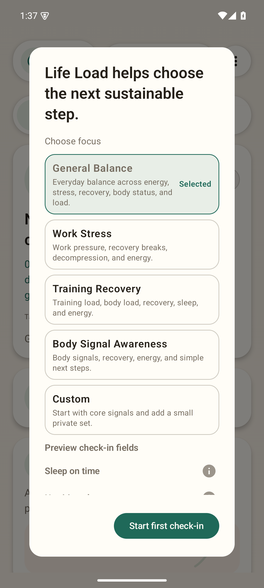
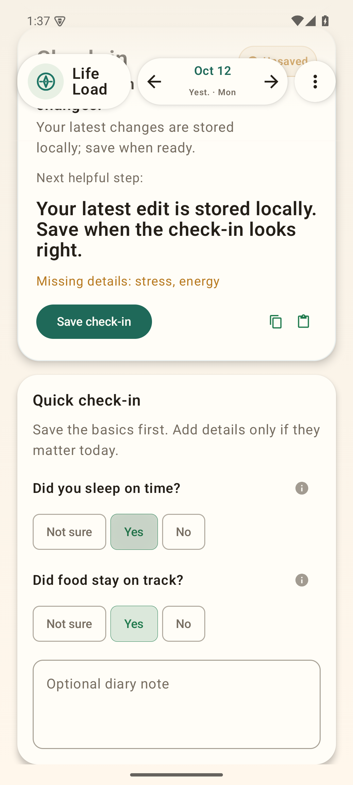
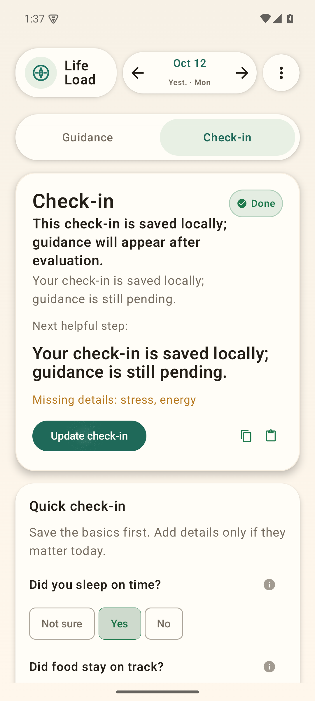
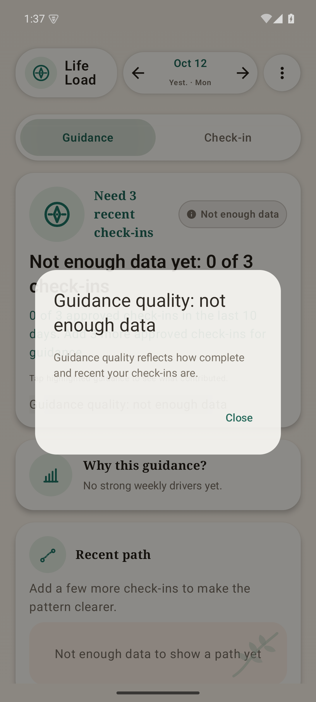

# Life Load

### Understand your load. Notice your patterns.

A short night, a demanding day, and low energy can be hard to see as one picture. Life Load explores a quieter way to record those signals and understand how a transparent model combines them.

This experimental Android/Python prototype brings together profile-based check-ins, local storage, explainable scoring and deterministic contracts. The source is here for people who want to inspect the model, adapt the workflow, or carry the project forward.

## A look inside

<table>
  <tr>
    <td valign="top"><strong>Choose your focus</strong><br></td>
    <td valign="top"><strong>Make a small check-in</strong><br></td>
  </tr>
  <tr>
    <td valign="top"><strong>Keep it locally</strong><br></td>
    <td valign="top"><strong>Understand the limits</strong><br></td>
  </tr>
</table>

Actual API 35 Android emulator captures with fictional input and no personal history. **The native offline demo saves pending check-ins; it does not compute canonical approval or populated weekly guidance.** The separate Python demo below performs real backend approval/scoring in its own local SQLite database. No native-to-backend synchronization is configured in this release.

## What you can explore

- **Start with a generic profile.** The Android demo enables `beta_review` and starts with `general_balance`, rather than a personal legacy setup.
- **Record a little, leave room for uncertainty.** Manual choices and local drafts distinguish missing input from explicit false or zero values.
- **Keep storage consequences visible.** Android queues local check-ins and offers local deletion. The backend keeps drafts separate from approved truth.
- **Inspect the model.** Python scoring exposes component contributions, reasons and deterministic golden cases; generic signal/profile contracts remain alongside their consumers.

This is a self-reflection and software research prototype, not a diagnostic, clinical or treatment tool. Its formulas, guidance labels and scores have no established clinical or outcome validity. It does not promise better health, recovery or performance.

## Run the verified Python example

Python **3.11+** is declared; **3.14.4 on Linux** was verified. Start with a fresh environment:

```sh
git clone https://github.com/jedufa/life-load.git
cd life-load
python3 -m venv .venv
.venv/bin/python -m pip install --require-hashes -r requirements-dev.txt
.venv/bin/python -m pip install --no-build-isolation --no-deps .
.venv/bin/python -m life_load.demo --state-root runtime/synthetic-demo
```

The command creates a fictional check-in and generic profile, promotes the backend draft into canonical SQLite truth, and prints the actual compatibility score/reasons plus generic profile bridge metadata. The installed wheel contains its JSON schema/contract/golden resources; no original checkout, existing diary, API key, HTTP server or external service is needed.

The native pending queue and backend approved database are deliberately separate demonstrations. The Python compatibility formula remains available alongside generic profile metadata; profile selection does not silently claim a different validated medical model.

## Build and try the Android source

Use **Java 17**, Android SDK **35** and build tools **34.0.0**, with the SDK environment configured. The official Gradle **8.9** wrapper and distribution checksum are included; AGP **8.5.2**, Kotlin **1.9.24** and resolved debug/test dependencies are pinned.

```sh
cd app/mobile/android
./gradlew --no-daemon :app:assembleDebug :app:testDebugUnitTest :app:assembleDebugAndroidTest
```

On your own disposable emulator, install the generated debug APK and open Life Load. Choose **General Balance**, start the first check-in, choose sleep/nutrition values and save. Restart the application to see the same choices. Local deletion is in the expanded Privacy section of Settings. These APKs are local build output; this release publishes no app binary or store listing. See [build and test](docs/BUILD_AND_TEST.md) for the two explicit instrumentation methods and clean-data assumptions.

Dependency resolution during setup/build uses PyPI, Gradle and Maven repositories. The Android application itself has **no INTERNET permission**, including transitive manifest merges, and requires no account for the demonstrated local workflow. Online controls/integrations are unsupported in this scoped release.

| Surface | Verified scope |
| --- | --- |
| Python | Fresh hashed dependencies, installed wheel/resources, canonical synthetic check-in/score/persistence |
| Android | Fresh debug build, 350 JVM tests, real Compose check-in/restart/delete with host SQLite checks |
| Product regressions | 525 Python tests including ten scoring-contract tests; unchanged formula thresholds |
| Images | Four authentic API 35 emulator captures; no mockups |
| First-party license | [MIT](LICENSE); [third-party terms](THIRD_PARTY_NOTICES.md) separately |
| Status | Experimental, unmaintained, looking for a maintainer |

Run the Python tests with `.venv/bin/python -m pytest -q -p no:cacheprovider tests/life_load`. The demonstrated evidence is engineering validation, not production or medical Qualification; coverage percentage was not measured.

## Privacy and limits

Android uses ordinary app SQLite/preferences; the Python demo writes ordinary local files. Neither is an encrypted vault. Exports can reveal their contents; retain local data appropriately and use synthetic records while experimenting. Experimental crypto/backup modules do not establish encrypted native storage or production backup security. See [security](SECURITY.md).

The snapshot excludes hosted developer/deployment servers, backend-test app, original diaries/research datasets, historical reports, gateway integration, original branding PNGs and private Git history. Optional Python Garmin, AI/Codex extraction, object-store and PostgreSQL integrations are unverified and unused by the documented demo. `cryptography` is an explicit runtime dependency; optional integration packages are separate extras. No paid/subscription infrastructure is configured.

Physical devices, reminder delivery/permissions, device-specific sharing/import/export, real provider calls, network privacy beyond the removed app permission, full native approval/weekly scoring and production hosting are unverified. The browser page in the original project was a placeholder and is omitted here. Windows/macOS and the declared minimum Python version were not separately exercised.

## Take it further

Inspect the scoring contract in `app/backend/life_load/`, the native app in `app/mobile/android/`, and shared signals in `app/shared/contracts/`. Keep formulas and tests together, and make uncertainty visible before adding stronger claims.

**Independent forks are welcome.** Support, PR review, security updates and future releases are not guaranteed. A new maintainer can take this prototype further; start with [contributing](CONTRIBUTING.md).

Copyright (c) 2026 Jean-Francois Dufour. First-party code and tests are [MIT licensed](LICENSE); upstream materials retain their own terms.
